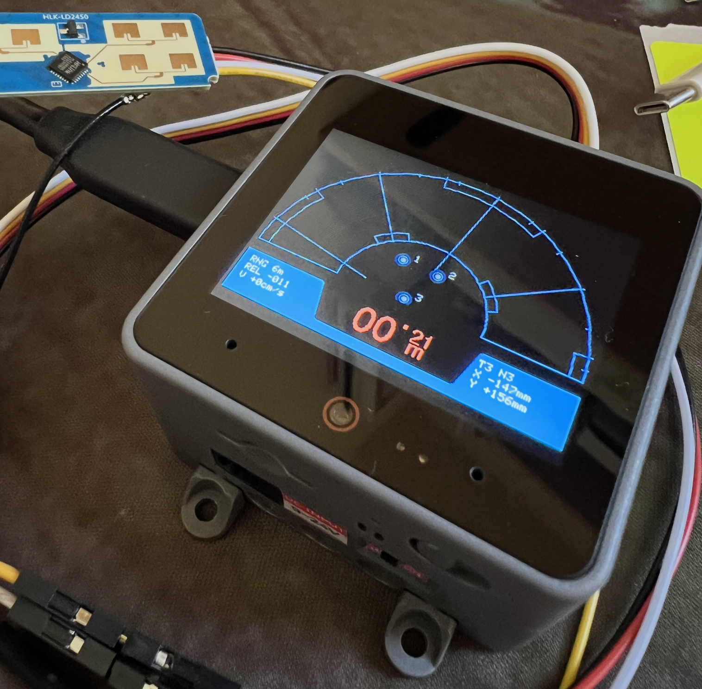

  
  
  

# M314
  

This project uses [HLK-LD2450](https://www.hlktech.net/index.php?id=1182) or [HLK-LD2460](https://www.hlktech.net/index.php?id=1335&cateid=768) and [M5Stack CoreS3](https://docs.m5stack.com/en/core/CoreS3) to build the [M314 Motion Tracker](https://avp.fandom.com/wiki/M314_Motion_Tracker?file=Motion_Tracker_detects_one_signal.png) display, sound effects and sensing — that USCM equipment featured in the movie *Aliens (1986)*.  

You can experience the vibe of the film — "anytime, anywhere"!

| Sensor | Port | Velocity measurement (cm/s) |
| --- | --- | -- |
| HLK-LD2450 | CoreS3 PORT.B | ✅ |
| HLK-LD2460 | CoreS3 PORT.C | ❌ |

> [!NOTE]  
> You can select the sensor to use when the device starts up screen.

## License
Original source code is licensed under the [MIT License](LICENSE).
